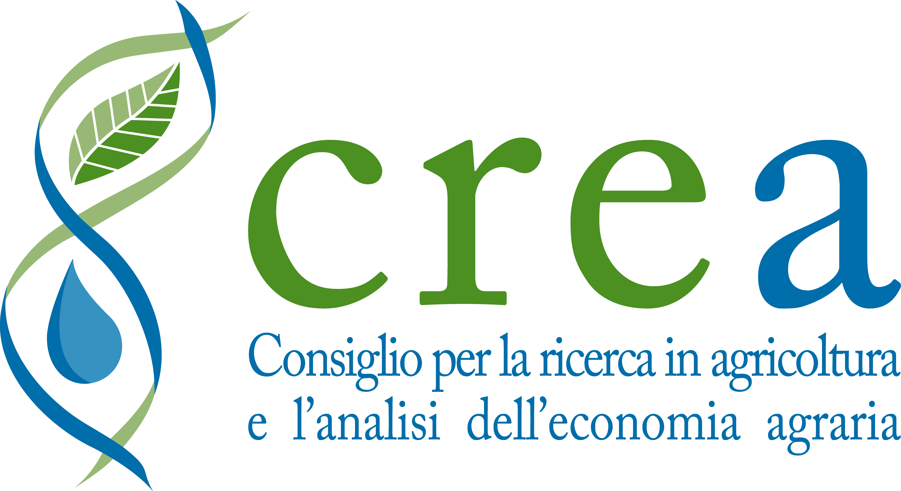
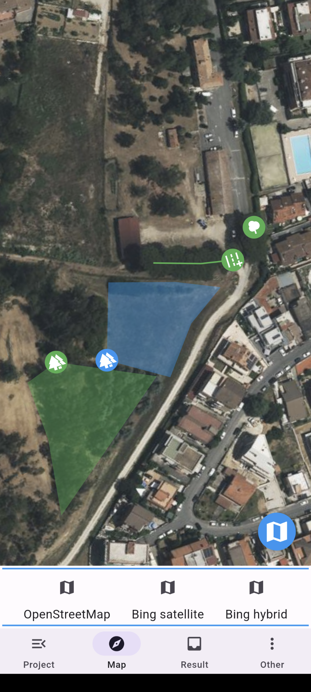
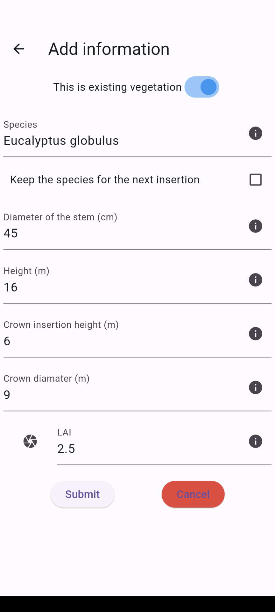
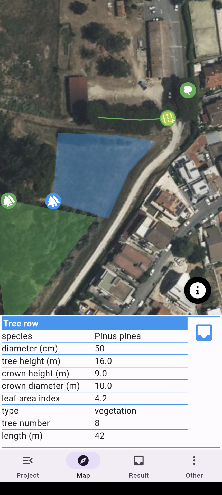
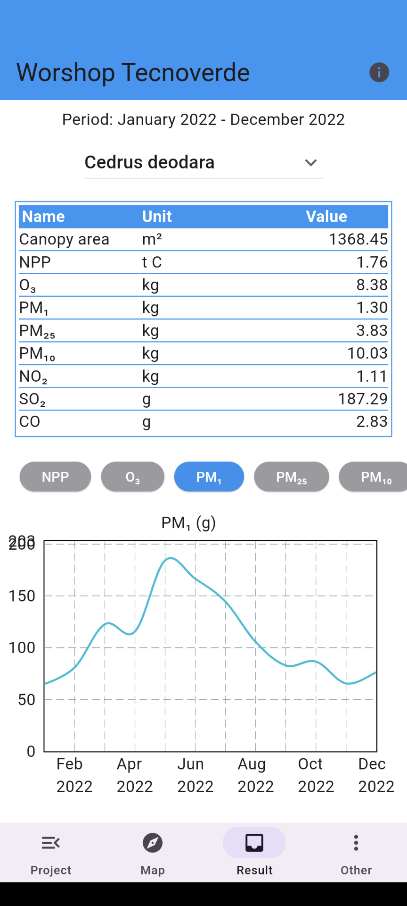

# Airtree app
&nbsp;&nbsp;&nbsp;&nbsp;&nbsp;&nbsp;&nbsp;&nbsp;


---

Copyright (c) 2023 Council for Agricultural Research and Economics (CREA)\
Fundings:  POR FESR Lazio 2014-2020 (POR), project TECNOVERDE, CUP B85F20003230006


     


## Description
The Airtree app allows you to survey and plan urban green within the Italian territory, with the possibility of geographically representing trees, rows and groves, and recording the species and various biometric characteristics, eg: trunk diameter, tree height.

This information can be transmitted to an Airtree server to estimate the quantities of carbon dioxide and air pollutants (e.g. particulate matter and ground-level ozone) removed by the trees.

The estimates are carried out with the Airtree model, implemented in the server and developed in collaboration between CREA and the National Research Council (CNR), which systematizes structural information of the trees (e.g. height of the tree, width of the crown), eco-physiological information (e.g. the speed of the chemical reactions involved in photosynthesis) and time series of climate data and air pollutants.

With this information, Airtree estimates the amount of light that is captured by the tree's canopy, simulates the opening of the stomata on the leaves (the pores through which trees breathe) and then calculates the amount of carbon and pollutants removed from the atmosphere.

## Purpose and use
Airtree is a field data-collection tool for urban forestry: field operators and
green-space managers survey street trees and groves on site and record their
species and biometric characteristics on a map, so that the collected data can
be sent to an Airtree server and turned into estimates of the air pollutants
removed by the vegetation.

## Platforms
Airtree app is currently being developed for Android.\
Testing through Goole play in coming soon

## Install from source code
1) set up an [Airtree server](https://github.com/aalivernini/airtree_server_public)
2) set up the [Flutter framework](https://docs.flutter.dev/get-started/install)
3) clone the repository into a your directory (DIR)
4) set up the app environment
- copy below text in your root DIR/.env

```
# GET YOUR OWN ARCGIS LOCATION PLATFORM API KEY FROM:
# https://location.arcgis.com/
# It is an ArcGIS Location Platform API key (not a portal token, not a JWT).
# It is sent to ArcGIS as the "token" query parameter of the basemap
# endpoints; "apiKey=" is rejected with error 499.
# STORE THE VALUE WITHOUT SURROUNDING DOUBLE QUOTES:
# a quoted value is rejected with error 498.
# example: ARCGIS_LOCATION_KEY=27.00000.00000.00000.00000
ARCGIS_LOCATION_KEY=MY_ARCGIS_LOCATION_KEY
# AIRTREE SERVER ADRESS. example: ADRESS_HOME=http://211.54.1.1:5000
ADRESS_HOME=MY_SERVER_ADRESS:5000
# YOUR CUSTOM AIRTREE KEY.
# USE THE SAME KEY TO SET UP YOUR AIRTREE SERVER
AIRTREE_KEY=7NEb35BAE.tMB0Nio0voyjXiTOwr0sGI
```
- edit the env file according to the comments
5) install the [envied](https://pub.dev/packages/envied) library
```
flutter pub add envied
flutter pub add --dev envied_generator
flutter pub add --dev build_runner
```
6) compile the env file and test the app on your android device
```
dart run build_runner build
flutter run
```

## Run
The Flutter SDK is not on the default PATH of this machine, so export it first:
```
export PATH=/home/alessandro/aa/pack/flutter/bin:$PATH
```
The envied part file `lib/env.g.dart` is generated and git-ignored, so it must
be generated before any build or run:
```
dart run build_runner build --delete-conflicting-outputs
flutter run
```
`flutter run` installs and starts the app on the connected Android device.

## Run tests
`lib/env.g.dart` is **generated** by `envied` and is **git-ignored**: it must
never be staged nor committed. Generate it before any build or test run, then
run the test suite:
```
dart run build_runner build --delete-conflicting-outputs
flutter test
```
The build **fails** when `ARCGIS_LOCATION_KEY` is missing from `.env`
(`Environment variable not found for field 'arcgisLocationKey'.`): the field is
deliberately not optional, because a silently empty key would downgrade every
user to the archived imagery.

## Smoke run
The canonical smoke command is a whole-program compile, which checks every
Dart file (including the generated `lib/env.g.dart`):
```
export PATH=/home/alessandro/aa/pack/flutter/bin:$PATH
dart run build_runner build --delete-conflicting-outputs
flutter analyze
flutter test
flutter build bundle
```
If `flutter build bundle` is unavailable in your environment, fall back to
`flutter build apk --debug` and then to `flutter build web --release`.
Note that the Flutter SDK is not on the default PATH, so the `export` line is
part of the smoke run.


